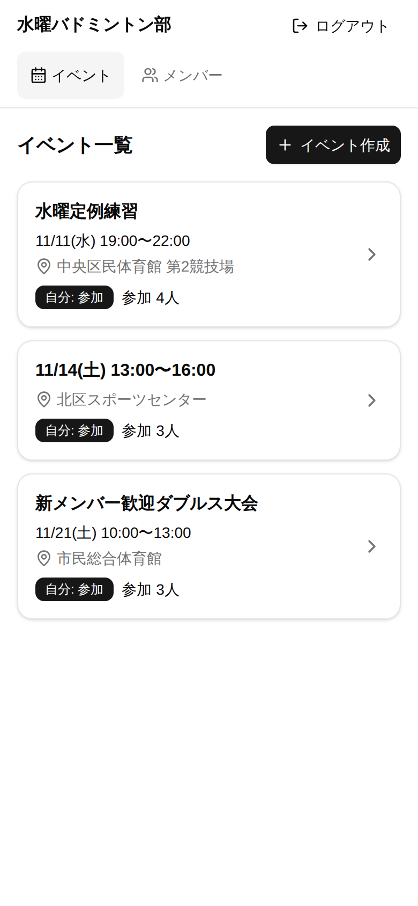
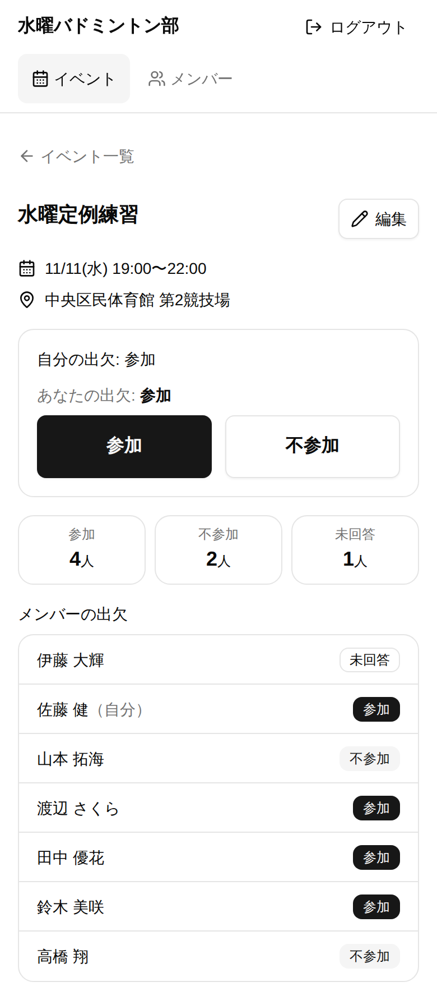
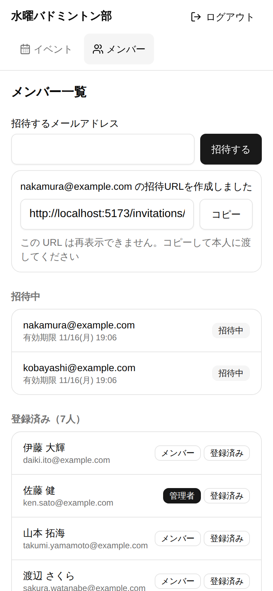
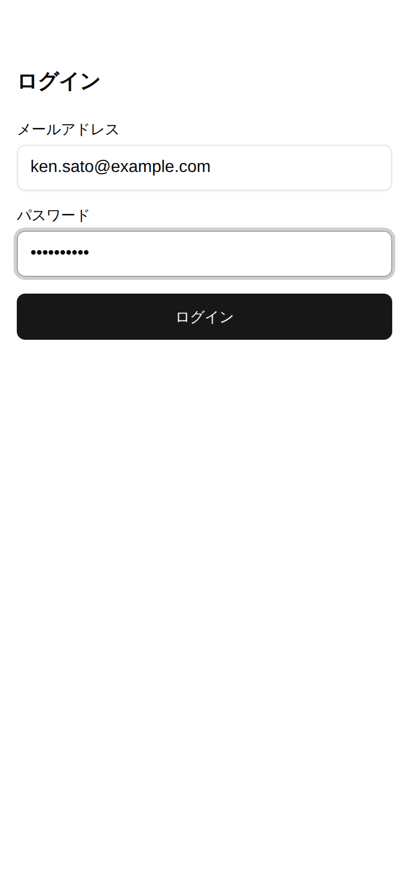
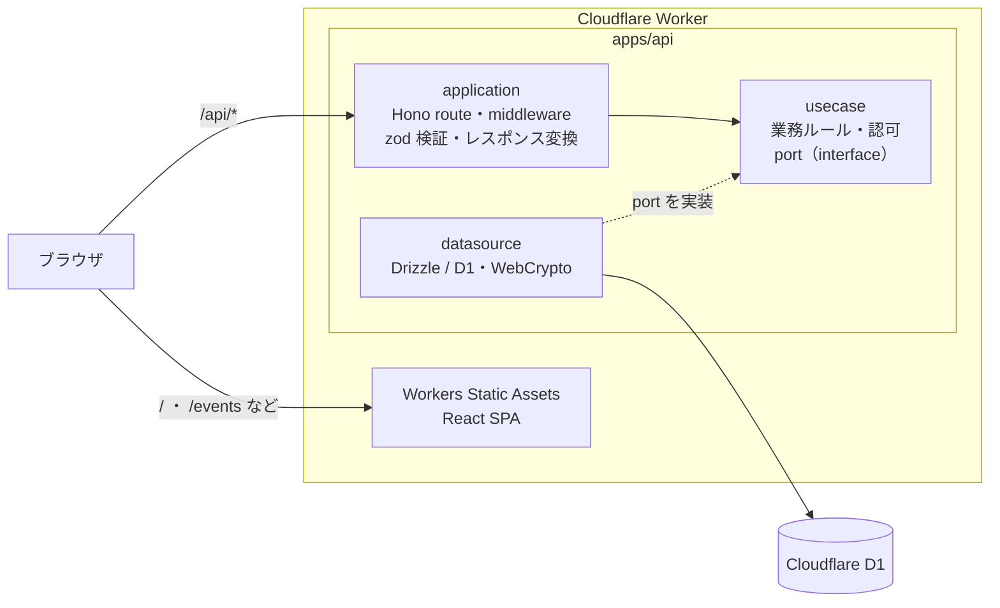

# minton-event

[](https://github.com/Kahra029/minton-event/actions/workflows/ci.yml)

バドミントンサークルの**練習・イベントの出欠管理アプリ**です。
サークルごとに独立したスペースを持ち、メンバーはスマートフォンから参加 / 不参加をワンタップで回答できます。

<table>
  <tr>
    <td align="center"><br>イベント一覧</td>
    <td align="center"><br>イベント詳細・出欠</td>
    <td align="center"><br>メンバー招待</td>
    <td align="center"><br>ログイン</td>
  </tr>
</table>

## 主な機能

| 対象 | 機能 |
|---|---|
| メンバー | サークル専用 URL からログイン / 今後のイベント一覧 / 出欠のワンタップ登録・変更 / 全メンバーの出欠確認 |
| 管理者 | イベントの作成・編集・削除 / メンバーの招待（招待 URL を発行して本人に渡す） / メンバー・招待状況の一覧 |
| 運用者 | サークルと最初の管理者を作る seed CLI |

スマートフォンでの利用を前提に、すべての画面を横スクロールなしで操作できるようにしています。

## 技術スタック

| 領域 | 技術 |
|---|---|
| フロントエンド | React 19 / TypeScript / Vite / TanStack Query / React Router / react-hook-form / Tailwind CSS / shadcn/ui |
| バックエンド | Hono（TypeScript）on Cloudflare Workers |
| DB | Cloudflare D1（SQLite）/ Drizzle ORM |
| 型・バリデーション | zod（API の契約を `packages/types` で web と api が共有） |
| テスト | Vitest / @cloudflare/vitest-pool-workers（D1 を使う結合テスト） / Testing Library / Playwright |
| インフラ | Cloudflare Workers（静的アセット配信で Web と API を 1 つの Worker から配信） |
| CI | GitHub Actions（typecheck / lint / unit・integration / E2E） |

## アーキテクチャ



- **API は 3 層構成**（application → usecase ← datasource）。usecase は Hono や D1 に依存せず、データアクセスは port（interface）越しに使います。
  依存の向きは ESLint の `no-restricted-imports` で機械的に守らせています。
- **DI ライブラリは使わず**、composition root（`apps/api/src/composition.ts`）がリクエストごとに依存を組み立てて Hono の context に入れます。
  usecase のテストは D1 を使わずフェイクの port で書けます。
- Web と API は**同一オリジン**で配信するため、CORS を開けずに HttpOnly Cookie のセッションをそのまま使えます。

## 設計で意識したこと

**マルチテナントの境界**
- すべてのクエリに Circle ID の条件を付け、他サークルのリソースを指定された場合は存在を明かさず 404 を返します。
- 認可はすべてバックエンドで判定します（画面でボタンを隠すだけに頼らない）。

**認証・秘密情報**
- パスワードは PBKDF2-SHA256（WebCrypto、100,000 回、ユーザーごとのランダムな Salt）でハッシュ化し、定数時間で比較します。
- セッション ID と招待トークンは 256 bit の乱数で、DB には SHA-256 ハッシュだけを保存します。
- セッションは HttpOnly / SameSite=Lax の Cookie。ログアウトするとサーバー側でも無効になります。
- ログイン・招待の受け入れには IP 単位の試行回数制限（Workers Rate Limiting）をかけています。

**ログとエラー**
- 構造化ログ（JSON 1 行）を出し、パスワード・トークン・セッションに当たるキーの値は自動で伏せます。
  招待トークンを含む URL パスは、実パスではなくルートのパターンで記録します。
- エラーレスポンスは `VALIDATION_ERROR` / `UNAUTHORIZED` / `FORBIDDEN` / `NOT_FOUND` / `CONFLICT` / `TOO_MANY_REQUESTS` / `INTERNAL_ERROR` の形式に統一し、スタックトレースを返しません。

## テスト

| 種類 | 件数 | 内容 |
|---|---:|---|
| API（unit / integration） | 215 | usecase の単体テスト（フェイクの port）と、ローカル D1 を使った API の結合テスト。サークル境界・権限・入力値の検証を網羅 |
| Web（component） | 57 | Testing Library による画面単位のテスト |
| E2E | 33 | Playwright。受け入れ条件のシナリオを mobile Chrome / mobile Safari / desktop Chrome の 3 環境で実行 |

## 開発の進め方

仕様の確定と設計判断を人が行い、実装は複数の AI エージェント（Claude Code）に並行して任せる進め方で作りました。

1. **仕様書を先に書く** — 受け入れ条件・実装上のガードレール・ドメインモデルと画面遷移（[docs/specs/](docs/specs/)）。
2. **未決事項は決定ログに残す** — 実装中に見つかった仕様の穴はエージェントが質問として上げ、人が決めた内容を [docs/decisions.md](docs/decisions.md) に記録します（A2〜C38）。エージェントが仕様を勝手に足さないことをルールにしています。
3. **基盤 → 機能別の並行実装 → E2E → セキュリティレビュー** — 機能ごとに担当と編集してよいファイルを分け、git worktree で並行に実装。最後に別のエージェントがセキュリティレビューを行い、指摘への対応方針も決定ログに残しています。

## ディレクトリ構成

```
apps/
  api/            Hono + Cloudflare Workers + D1
    src/
      application/  route・middleware・エラー変換・ログ
      usecase/      業務ルール・認可・port
      datasource/   D1（Drizzle）・暗号・ID 生成
      composition.ts
    migrations/     D1 の Migration
    scripts/        seed CLI
  web/            React SPA（機能ごとのディレクトリ構成）
packages/types/   zod スキーマ（API の契約）
e2e/              Playwright
docs/             仕様書・決定ログ・アーキテクチャ・デプロイ手順
```

詳しい構成と実装規約は [docs/architecture.md](docs/architecture.md)、デプロイ手順は [docs/deploy.md](docs/deploy.md) にあります。

## ローカルで動かす

Node.js 22.18 以上が必要です。

```sh
npm install
cp apps/api/.dev.vars.example apps/api/.dev.vars   # APP_BASE_URL（招待 URL の基準）
npm run db:migrate:local
npm run dev                                          # web: http://localhost:5173（/api は wrangler dev に proxy）
```

```sh
npm run typecheck && npm run lint && npm test
npm run test:e2e                                     # Playwright（初回は npx playwright install chromium webkit）
npm run build                                        # web をビルド（apps/web/dist）
# npm run deploy                                     # build してから wrangler deploy（手順は docs/deploy.md）
```

### 初期 Circle / admin の作成（seed CLI）

運用者が最初の Circle と admin を作ります（decisions A5）。Migration 適用後に `apps/api` で実行します。

```sh
cd apps/api
node scripts/seed.ts --circle-login-id <circleLoginId> --circle-name <サークル名> --email <admin の Email> --name <表示名>
# → admin の Password を非表示で 2 回入力（8〜128 文字）
# → 完了するとログインURL /login/<circleLoginId> が表示される
```

- 既定はローカル D1（`wrangler d1 execute --local`）。Cloudflare 上の D1 には `--remote` を付けます（[docs/deploy.md](docs/deploy.md)）。
- **Password は引数・環境変数で渡しません**（シェル履歴・プロセス一覧に残るため）。端末で入力するか、
  パスワードマネージャ等からパイプします: `<pw を出力するコマンド> | node scripts/seed.ts ...`（標準入力の 1 行目を使う）。
- 同じ circleLoginId が既にある場合は失敗し、何も作りません。
